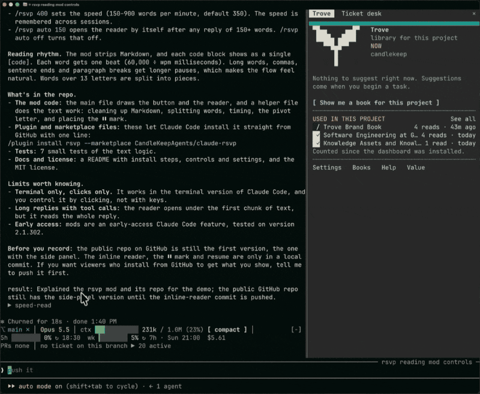

# rsvp: speed-read Claude's replies

`rsvp` is a mod for Claude Code. It shows Claude's reply one word at a time, in one fixed position, directly below the reply. This method is RSVP (rapid serial visual presentation). Your eyes do not move across the text, so you can read faster.



The pivot letter of each word is red. It is always in the same column, below a marker. When you stop, a `⏸` mark shows in the reply text before the word where you stopped.

```
⏺ Rivers bend because water rarely flows in a straight line. ...
  Once a bend forms, it tends to feed itself. The current ⏸ keeps swinging wider ...

  ┄┄┄┄┄┄┄┄┄┄┄┄┄┄┄┄┄┬┄┄┄┄┄┄┄┄┄┄┄┄┄┄┄┄┄┄┄┄┄┄┄┄┄┄┄┄┄┄┄┄
                  keeps
  ┄┄┄┄┄┄┄┄┄┄┄┄┄┄┄┄┄┴┄┄┄┄┄┄┄┄┄┄┄┄┄┄┄┄┄┄┄┄┄┄┄┄┄┄┄┄┄┄┄┄
  ██████████████████████████████████░░░░░░░░░░░░░░░░ 68/99 · 350 wpm · stopped
  [ ▶ play ] [ ◀ sentence ] [ sentence ▶ ] [ − slower ] [ + faster ] [ ⏮ ] [ ✕ close ]
```

## Install

At the prompt of a Claude Code terminal session, type:

```
/plugin install rsvp --marketplace CandleKeepAgents/claude-rsvp
```

Type `y` to add the marketplace. Then push Enter to select the user scope.

From a shell:

```
claude plugin install rsvp --marketplace CandleKeepAgents/claude-rsvp
```

In the desktop app, `/plugin` does not operate. Click **+** next to the prompt box, then **Plugins**. Add the marketplace `CandleKeepAgents/claude-rsvp`, then add the plugin.

The mod operates in the terminal and in the Claude Code desktop app. A mod that you install from a terminal at the user scope also loads in the desktop app. Mods are an early-access feature of Claude Code. We tested this mod on Claude Code 2.1.302.

## Use

There are two ways to start the reader:

- Click **▶ speed-read** below a reply.
- Type `/rsvp`. The reader opens below Claude's last reply.

The reader opens below the reply and starts to play. Click the buttons to control it:

| Button | Action |
|---|---|
| **⏸ stop** / **▶ play** | Stops or continues the reader |
| **◀ sentence** | Goes back one sentence |
| **sentence ▶** | Goes forward one sentence |
| **− slower** | Decreases the speed by 25 words per minute |
| **+ faster** | Increases the speed by 25 words per minute |
| **⏮** | Goes back to the start |
| **✕ close** | Closes the reader |

When you stop or close the reader in the middle of a reply, the `⏸` mark shows where you stopped. The button below the reply changes to **▶ resume speed-read at 68/99** and **⏮ from the start**. Each reply keeps its own position. Only one reader plays at a time. When you start a reader, the reader that plays stops at its position.

## Summary

Click **✦ summarize** below a reply to get a short summary of that reply. The mod sends only the text of that reply to Sonnet. Sonnet does not get the rest of the session. The summary uses your Claude plan.

The summary shows in a box with a border below the reply. It has two parts:

- **What happened**: two or three sentences.
- **What you need to do**: the decisions, answers or actions that the reply asks of you, or "Nothing, it's done."

Click **▶ speed-read summary** to read the summary one word at a time. The reader opens in the summary box and has the same buttons. The summary reader keeps its own position, separate from the reader of the reply. Click **✕ hide summary** to remove the summary and its reader.

## Settings

| Command | Result |
|---|---|
| `/rsvp 400` | Sets the speed to 400 words per minute and starts the reader. The range is 150 to 900. The default is 350. |
| `/rsvp auto 150` | Opens the reader automatically after each reply of 150 words or more. |
| `/rsvp auto off` | Stops the automatic reader. This is the default. |

The mod keeps the speed and the automatic setting for all sessions.

## How it works

- The mod removes Markdown marks. A code block shows as one word, `[code]`.
- A word stays on screen for one beat (60,000 ms ÷ words per minute). A long word stays 30% longer. A comma adds 50%. The end of a sentence makes the time 2.5 times longer. The end of a paragraph makes it 3 times longer.
- The mod divides a word of more than 13 letters into parts.
- The `⏸` mark changes only the display. The mod does not change the conversation or what Claude reads.

## Develop

Run the mod from this folder:

```
claude --plugin-dir .
```

Validate it and run the tests:

```
claude plugin validate .
claude plugin test .
```

## License

MIT
